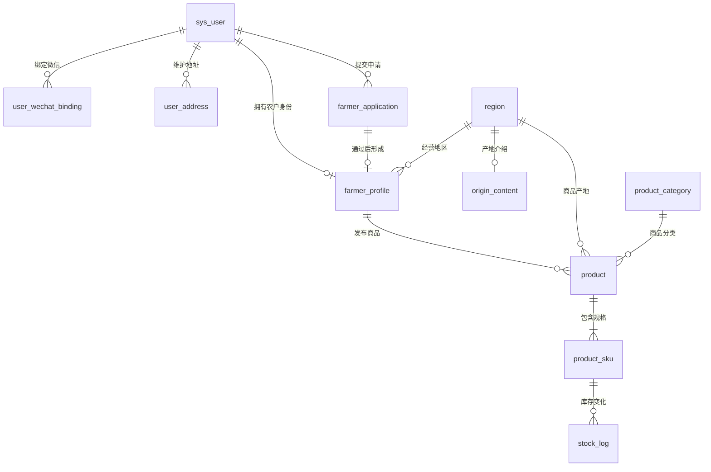
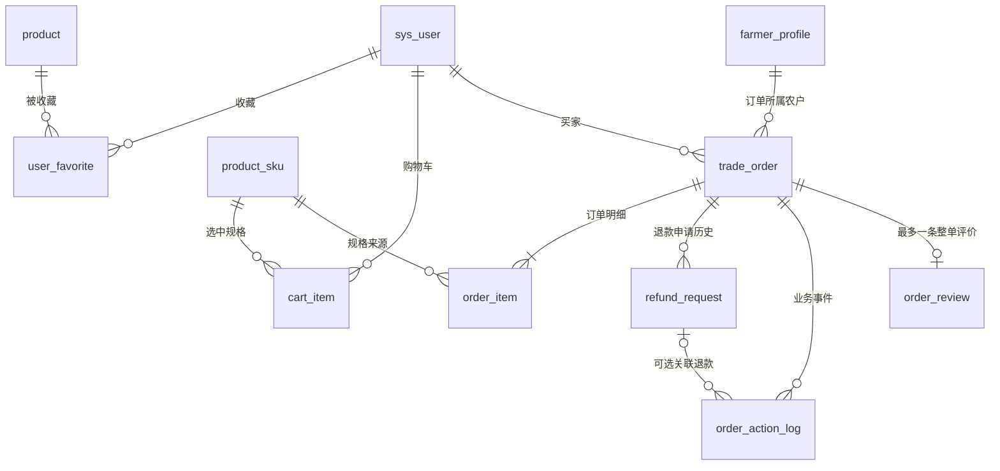
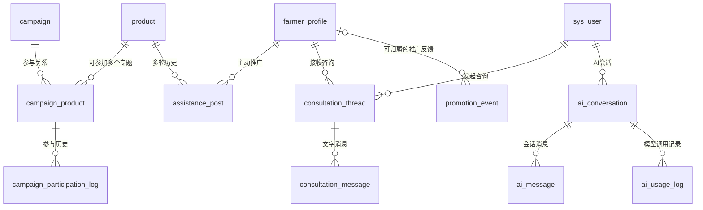

# 数据库设计

版本：V1 数据库设计入口。整理日期：2026-11-19。目标数据库：MySQL 8.0.16 及以上的 8.0 系列。

本文件说明核心表清单和主要关系；现已补齐 [完整字段字典](数据库字段字典.md)、[实现与迁移说明](数据库实现与迁移说明.md) 和 [V1 建表 SQL](../../backend/src/main/resources/db/migration/V1__initial_schema.sql)。字段类型、必填性、默认值、枚举、索引与行内约束以字段字典及 SQL 为准；接口契约尚待编写。当前没有创建或修改实际数据库，静态校验不代表目标 MySQL 8.0 已执行成功，也不代表应用已经实现。

业务依据：[功能总览](../requirements/功能模块与主要页面总览.md)、[需求文档](../requirements/需求文档.md)、[项目决策记录](../项目决策记录.md)。原先逐条整理的数据边界保存在 [数据库设计约束](数据库设计约束.md)，需要核对某项规则时再查，不必先通读全部细节。

## 1 先看懂整体结构

已有八个功能模块暂归为 **29 张逻辑表**。这些表是同一套单体应用的数据结构，不是新增 29 个功能模块，也不要求每张表都有独立管理页面。

| 数据分组 | 表数 | 主要解决的问题 |
| --- | --- | --- |
| 账号与农户 | 5 | 谁在使用、微信绑定、收货地址、谁是农户、首次入驻审核 |
| 地区与商品 | 5 | 来自哪里、属于什么分类、商品规格、价格库存和库存变化 |
| 购物与交易 | 7 | 收藏购物车、订单明细、退款、业务记录与整单评价 |
| 助农与内容 | 5 | 专题、商品参与、参与历史、农户助农信息和产地介绍 |
| 留言与推广反馈 | 3 | 双方文字沟通、未读以及推广带来的浏览和咨询 |
| AI 与管理日志 | 4 | AI 会话消息、模型调用用量、重要管理操作 |

## 2 本轮采用的建模方式

以下是开发设计选择，不新增“用户已确认”的业务决策编号。

- 用户只有一套平台账号，农户资料通过唯一的 `user_id` 扩展账号；管理员身份单独表达，不把用户、农户和管理员设计成互相排斥的单选身份。不建设多岗位 RBAC 权限表体系。
- 商品与规格分表：商品保存介绍与归属，规格保存每份价格和可售库存。商品图片先按有序 JSON 列表保存存储对象引用；评价图片同理，继续遵守最多三张的已有规则，不建设独立图库模块。
- 模拟支付结果和一次模拟发货信息先放订单中；业务日志保存有效操作。不建真实支付网关流水、资金账户或物流轨迹表。
- 每单最多一条评价、每条最多一次农户回复，回复字段先放在同一评价记录中；评价与回复各自的隐藏状态仍分别保存。
- 专题和商品使用一份当前参与关系，再追加参与事件记录，兼顾重复报名限制、合法重报和历史查询。临时不可见、主动退出及管理员移出分别表达。
- 推广反馈先存事件并查询汇总，不同时建设多套日报、排行榜或收益账本；AI 用量单独按每次模型调用保存。

原逻辑模型中的两项简化建议，现按用户允许常规设计自主推进的要求落实为本轮实施选择；没有新增“用户已确认”的业务决策：

| 实施选择 | 当前模型如何表达 | 设计状态 |
| --- | --- | --- |
| 农户故事先作为主页的一份图文介绍 | `farmer_profile.story_content` 保存受限 JSON 图文块，不单独增加文章列表和故事表 | 已采用的实现方式，不表示用户曾逐项选择篇数 |
| 同一用户与同一农户共用留言会话 | `consultation_thread` 按双方唯一，消息可附带不同商品或推广来源 | 已采用的实现方式，消息序号和双侧已读位置见字段字典 |

## 3 核心表清单

下表是结构摘要；完整字段（包括 `id`、时间、默认值、唯一键等）已在字段字典中逐表列出。英文名用于后续代码，中文名说明每张表的用途。

### 3.1 账号与农户（5 张）

依据：FR-AUTH-001、FR-ROLE-001、FR-FARM-001 至 FR-FARM-004、FR-ORDER-004。

| 表名 | 中文用途 | 关键字段方向与关联 |
| --- | --- | --- |
| `sys_user` | 平台账号 | 账号、密码哈希、昵称、头像、账号状态、管理员标识；普通账号与农户共用登录，不保存明文密码 |
| `user_wechat_binding` | 微信绑定 | `user_id`、`app_id`、`open_id`、可选 `union_id`、绑定时间；同一微信应用下的微信身份不得同时归属多个账号 |
| `user_address` | 用户收货地址 | `user_id`、收件人、手机号、地区、详细地址、默认标记；地址簿变化不更新旧订单地址快照 |
| `farmer_profile` | 农户经营资料 | 唯一 `user_id`、通过的申请引用、名称、地区、主营品类、联系手机号、简介封面、固定运费、经营状态；故事字段采用上述实施设计 |
| `farmer_application` | 首次入驻申请记录 | `user_id`、本次提交的四项必填与选填资料、审核状态、提交及审核时间、审核人和原因；通过后形成农户资料，经营资料修改不覆盖审核事实 |

账号可以有申请历史；一个账号最多对应一份农户经营资料。保存多次申请记录不意味着已经开放所有撤回、重提操作。微信身份的唯一识别与“每个平台账号能绑定几个微信”的业务限制分别处理，后者仍按账号模块设计落实。

### 3.2 地区与商品（5 张）

依据：FR-REGION-001、FR-PRODUCT-001 至 FR-PRODUCT-006、FR-INV-001、FR-INV-002。

| 表名 | 中文用途 | 关键字段方向与关联 |
| --- | --- | --- |
| `region` | 地区目录 | 地区标识、名称、`parent_id`、层级和状态；供商品产地、农户地区及地址引用 |
| `product_category` | 商品分类 | 分类标识、名称、`parent_id`、显示顺序和状态；支持专题选择分类及其下级 |
| `product` | 农产品资料 | `farmer_id`、`category_id`、`origin_region_id`、名称、介绍、图片列表、储存方式及应季月份；农户上下架与管理员限制分开记录 |
| `product_sku` | 商品规格与库存 | `product_id`、规格名称、单价、可售份数、规格可用状态；一个商品有一行或多行手工规格 |
| `stock_log` | 库存变动记录 | `sku_id`、可选 `order_item_id`、变动原因、增减份数、变动前后数量、操作者及业务操作标识；关联下单预占、返还或人工调整 |

专题按商品自身的地区／分类节点判断，不能用农户资料代替。图片引用只存可控的资源标识，不存图片二进制或带密钥的上传地址。规格生命周期仍需和已有订单规则协调，表中有状态字段不等于新增随意删除历史规格的权限。

### 3.3 购物与交易（7 张）

依据：FR-CART-001、FR-SHIP-001、FR-SHIP-002、FR-ORDER-001 至 FR-ORDER-006、FR-REFUND-001 至 FR-REFUND-006、FR-REVIEW-001 至 FR-REVIEW-008；收藏入口见页面与导航说明。

| 表名 | 中文用途 | 关键字段方向与关联 |
| --- | --- | --- |
| `user_favorite` | 商品收藏 | `user_id`、`product_id`、收藏时间；同一用户对同一商品最多一份收藏 |
| `cart_item` | 购物车明细 | `user_id`、`sku_id`、购买份数；同用户同规格合并，查询时按所属农户分组，加入购物车不占库存 |
| `trade_order` | 订单主表 | 订单号、买家 `user_id`、`farmer_id`、订单状态、商品款／运费／总额快照、四项收货信息快照、固定备注；付款截止、模拟支付、模拟承运方单号、发货及完成时间、完成来源 |
| `order_item` | 订单商品明细 | `order_id`、`product_id`、`sku_id`；下单时商品名称／规格／图片／单价快照、份数、小计及库存占用／返还标记 |
| `refund_request` | 发货前整单退款 | `order_id`、申请人、退款金额、申请原因、当前处理阶段、阶段开始时间、农户拒绝与复核信息、当前处理人、结果及结束时间；保留 24 小时复核和 48 小时待办所需时间依据 |
| `order_action_log` | 订单与退款业务记录 | `order_id`、可选 `refund_id`、动作、操作者、发生时间、状态变化与必要原因；记录支付、取消、发货、收货、退款审核／复核／撤回／接手，不只记录管理员动作 |
| `order_review` | 整单评价与一次回复 | 唯一 `order_id`、买家与农户归属、星级、文字、图片列表、提交时间；一次回复内容和时间；评价隐藏与回复隐藏分别表达，管理原因与事件由操作日志追踪 |

一笔订单只属于一个农户，至少包含一条明细。退款表保留申请历史，但不因此开放未确认的重复申请次数；同时有效申请的约束在字段与事务设计中落实。订单金额和收货资料保存快照，查询旧订单不依赖当前商品价格或地址簿。公开评价由接口统一匿名投影，数据库仍保留真实归属供权限校验。

### 3.4 助农与内容（5 张）

依据：FR-PROMO-001 至 FR-PROMO-033、FR-CONTENT-001。

| 表名 | 中文用途 | 关键字段方向与关联 |
| --- | --- | --- |
| `campaign` | 管理员助农专题 | 标题、普通文字介绍、选填封面、草稿／发布标记、真实发布时间、原计划起止、可空地区／分类限制；实际结束时间与来源、整体隐藏及管理记录关联 |
| `campaign_product` | 专题当前商品参与 | `campaign_id`、`product_id`、当前参与状态、参与轮次、最近加入／退出时间及定向移出限制；同专题同商品唯一，价格库存仍读取原商品 |
| `campaign_participation_log` | 专题参与事件历史 | `campaign_product_id`、参与轮次、加入／退出／移出／解限等动作、有效时刻、操作者和原因；区分过去参与与当前参与，用于结束时点回溯 |
| `assistance_post` | 农户主动助农信息 | `farmer_id`、`product_id`、标题、推广说明、选填供货时间和买家类型、首次发布时间、固定截止、实际结束时间与来源；保留旧轮次，支持同商品活动名额与七天等待校验 |
| `origin_content` | 产地介绍 | `region_id`、标题、图文内容、封面及管理维护信息；本轮按一个地区一份介绍建模，不扩展文章社区 |

专题当前参与与参与历史分开，是为了退出后可重报、移出后须解限重报及结束历史能查清。商品下架或条件不匹配导致的暂隐藏不写成退出，也不释放有效参与名额。专题的预告／进行／结束阶段结合发布时间、计划时间和实际结束事实计算，整体隐藏另行判断，恢复公开不等于重新开始。

助农信息属于一个商品，可有多轮历史；数据库不能对 `product_id` 直接建立终身唯一限制。因条件不匹配隐藏的专题参与如何进入结束历史仍是未决业务边界，本稿只保留必要事实，不提前决定纳入或排除。

### 3.5 留言与推广反馈（3 张）

依据：FR-COMM-001、FR-COMM-002、FR-PROMO-003；不恢复 FR-INTENT-001 已后置的意向单。

| 表名 | 中文用途 | 关键字段方向与关联 |
| --- | --- | --- |
| `consultation_thread` | 用户与农户留言会话 | 咨询用户 `user_id`、接收 `farmer_id`、最近消息／活动时间及双方读取位置；按用户与农户唯一归并，消息带各自来源 |
| `consultation_message` | 站内文字消息 | `thread_id`、发送账号、文本、发送时间；可选关联商品、专题或助农信息来源，双方按会话归属访问 |
| `promotion_event` | 推广浏览与咨询事实 | 事件类型、发生时间、可空登录用户／匿名访客标识、相关农户与商品、专题或助农信息来源、可选来源消息引用；用于有归属依据的浏览和咨询汇总 |

读取位置、消息序号和统计去重已在实现说明中落实，报表查询参数在接口契约补齐。来源关联由后端校验，不能信任客户端任意填入的农户或专题；平台级专题访问未指向具体农户时，不把一次访问算给全部参与农户。事件不等于成交、采购意向或真实增收；匿名访客标识不设计成身份证明，不为统计新增收集真实身份资料。

### 3.6 AI 与管理日志（4 张）

依据：FR-AI-001 至 FR-AI-007、FR-ROLE-001。

| 表名 | 中文用途 | 关键字段方向与关联 |
| --- | --- | --- |
| `ai_conversation` | 用户 AI 会话 | `user_id`、标题、创建及最近活动时间、会话可用状态；会话归属必须按用户隔离 |
| `ai_message` | AI 会话消息 | `conversation_id`、业务请求标识、角色、内容、消息状态和发送时间；推荐卡片引用平台商品，展示时仍校验当前可购买信息 |
| `ai_usage_log` | 每次模型调用用量 | `conversation_id`、业务请求标识、内部调用标识、平台／模型、输入输出 token、预估及已记录费用、计价依据、用量来源与调用结果；未知用量单独表示，失败不自动按零费用处理 |
| `admin_operation_log` | 重要管理操作日志 | 管理员、目标类型与标识、动作、原因、发生时间、结果和必要的脱敏变化摘要；不保存密码、密钥或整段私密会话 |

一次用户发送可能触发多次模型调用，因此 `ai_usage_log` 不与用户消息做一对一绑定。会话／消息表用于持久化归属和消息，不代表无限期保留全部聊天；保留与删除策略在 AI 模块设计时明确。Redis 存近期上下文和限流数据，MySQL 保留业务归属与可核对的用量事实，不创建“每日五次”的固定额度字段。

## 4 核心关系图

图中一对多表示业务归属。本版使用逻辑关联，不声明物理外键；后端事务负责存在性、归属与删除限制，详见实现说明。为便于阅读，分三幅图展示主干，日志和所有辅助字段不逐一画出。

### 4.1 账号、农户与商品

### 4.2 购物、订单与退款评价

### 4.3 助农推广、咨询和 AI

地区与分类的自身树关系通过 `parent_id` 表达。`promotion_event` 可关联专题、助农信息、商品及来源消息，具体可空条件在数据字典展开；上图不代表一个事件可以同时无约束地归属多个来源。管理员日志的目标可跨业务表，需通过受控目标类型与标识解析。

## 5 主要状态怎样保存

下表是逻辑状态划分；英文枚举与代码值已在字段字典及实现说明中展开，对外接口映射见 [接口文档](../api/接口文档.md)。

| 对象 | 状态或事实 | 设计重点 |
| --- | --- | --- |
| 账号／农户 | 账号状态、经营状态各自保存 | 限制农户经营与限制账号登录不是同一个字段；联动权限仍按业务规则 |
| 入驻申请 | 待审核、通过、退回 | 保存每次提交及审核结果，不能被后续经营资料覆盖 |
| 商品 | 农户上架状态与管理员强制下架限制分别保存 | 缺货只是规格数量条件，不能用补货解除管理限制 |
| 订单 | 待付款、待发货、待收货、已完成，以及关闭或退款结束 | 退款待处理不覆盖原履约阶段，发货资格结合当前退款流程判断 |
| 退款 | 农户待处理、拒绝后的复核窗口、管理员待处理、已退款、已拒绝结束或撤回 | 阶段开始、拒绝、复核与接手事实可追溯；24／48 小时从对应有效时间计算 |
| 专题 | 草稿／已发布、原起止、实际结束事实、整体隐藏分别表达 | 页面阶段由这些事实计算，隐藏不暂停计时，不改写首次结束结果 |
| 专题参与 | 已加入、主动退出、管理员移出及其限制；参与轮次和事件历史 | 下架或不匹配暂隐藏不改成退出，解限不自动加入 |
| 助农信息 | 首次发布、固定截止、实际结束来源与时间 | 暂隐藏不重设计时，不启动七天等待；正常结束以有效结束时间起算 |
| 评价／回复 | 已提交事实与各自公开隐藏状态 | 隐藏不删除评价资格记录，也不允许再次提交或再次回复 |
| AI 调用 | 待调用、成功、失败、用量待核对等结果维度 | 内容生成失败与是否发生费用分别表达，不能把未知用量当成零 |

## 6 必须落实的约束与索引方向

- 主要唯一关系：账号登录名、农户的 `user_id`，微信的 `app_id + open_id`，收藏的 `user_id + product_id`，购物车的 `user_id + sku_id`，订单号，评价的 `order_id`，专题参与的 `campaign_id + product_id`。留言双方唯一和产地单份内容也已落实到唯一键。
- 商品列表围绕分类、地区、农户及可见状态设计索引；用户／农户订单围绕归属、状态和创建时间设计索引，不为每个字段机械加索引。
- 定时扫描需要订单状态＋付款截止、订单状态＋自动收货截止，以及退款阶段＋阶段开始时间。执行仍重新校验当前有效状态，不以索引结果代替业务判断。
- 下单和整单取消／退款返还要保持订单明细、规格可售数量和库存日志一致。可售库存不能为负，不足时不能留下有效订单或部分扣减；整单所有明细一起成功或回滚。使用数据库事务与有效操作标识防止重复生效；支付不再次扣库存，返还按原明细数量执行，整单退款不能重复成功。
- 专题报名与退出、移出、重报的当前记录和事件历史一起保存。历史查询需要有效时刻与确定的事件顺序，不能靠结束任务运行时的可见列表重算参与。
- 助农信息的“同商品最多一条未结束”和结束后七天等待属于状态及时间约束，后续在事务中对同商品串行检查，不直接用终身 `product_id` 唯一索引代替。
- 业务历史优先保留引用和快照；不得用级联删除商品、用户或规格的方式连带删掉订单、评价、退款与必要操作历史。具体删除和保留策略随字段字典落实。

交易金额采用 DECIMAL(12,2)，数量采用整数份数，ID 使用 BIGINT，时间使用保存 UTC 的 DATETIME(3)。订单金额／库存以 MySQL 为准，Redis 用于缓存、会话与频率控制。模型费用使用 DECIMAL(18,8)，并区分预留、未知、估算与上游报告；实际价格、预算额度和并发控费程序在 AI 模块落实。

## 7 本轮完成范围与下一步

已形成：29 张表的用途、三幅主干 ER 图、完整字段字典、枚举／关联与事务说明、唯一键和索引、V1 版本化 SQL，以及字段字典与 SQL 的静态一致性检查脚本。原有业务边界未被删掉，见 [数据库设计约束](数据库设计约束.md)。

主要页面与流程的 [接口契约](../api/接口文档.md) 已形成，涵盖方法、路径、鉴权、DTO、分页、业务错误和关键操作效果。下一步初始化后端与前端、核对依赖兼容版本。迁移脚本放在 [后端迁移目录](../../backend/src/main/resources/db/migration/)，演示数据单独放在 [演示数据目录](../../backend/src/main/resources/db/seed/)。本轮未执行建库或连接已有数据库；实际 MySQL 8.0 迁移验证待隔离环境具备后执行。

故事载体、留言归并及基本推广计数已作为实施设计落到配套说明；AI 历史保留和实际预算等仍在对应模块集中落实。低优先级问题不阻塞其他设计，但涉及核心权限或交易结果的未决项不会被字段默认值偷偷决定。2026-11-20 已补充确认退款重申（FR-REFUND-007）和提交前变价重确认（FR-ORDER-007）；接口细化时为助农发布补入原始请求摘要字段，完善仍处设计阶段、尚未执行的 V1。

首版没有采购意向、互助任务、农户 AI 宣传、优惠券／积分、真实资金、真实物流、RAG 或向量表。日后扩大范围时再增加相应设计与迁移。
